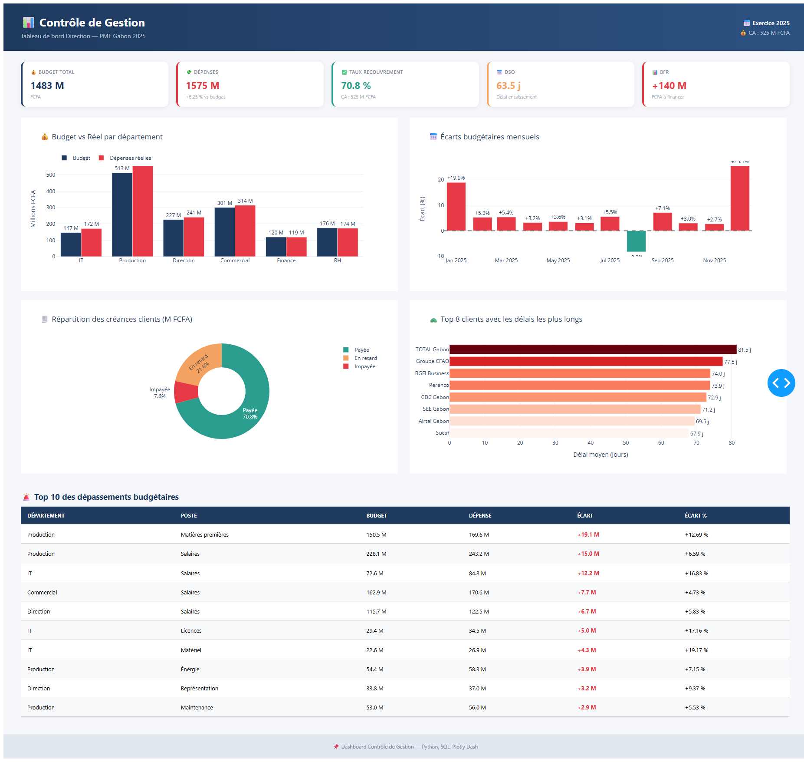
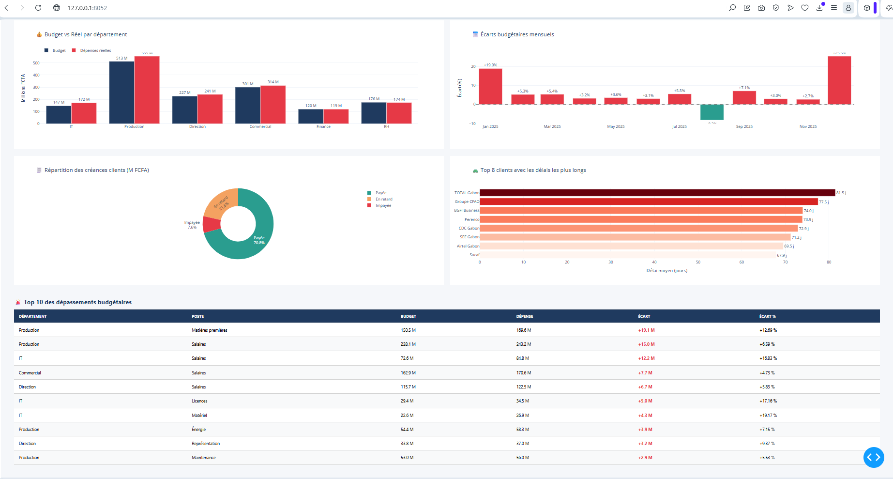
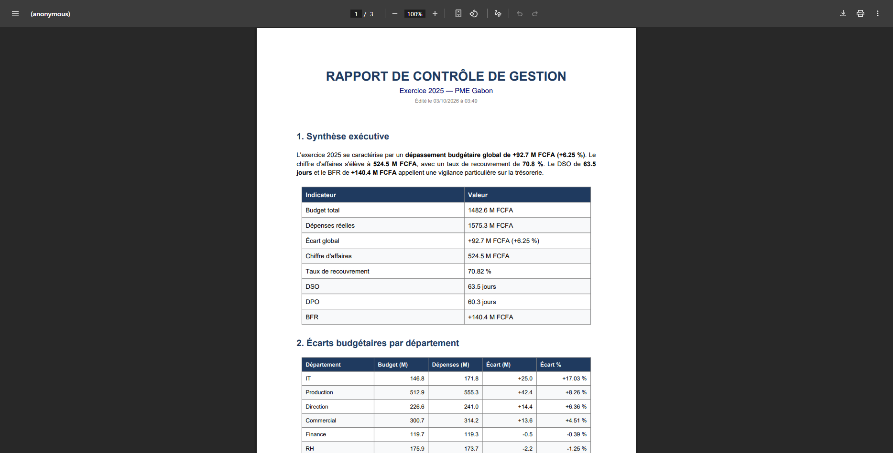

# 📊 Contrôle de Gestion — Dashboard & Reporting Automatisé

[](https://www.python.org/)
[](https://pandas.pydata.org/)
[](https://plotly.com/)
[](https://dash.plotly.com/)
[](https://www.sqlite.org/)
[](https://www.reportlab.com/)
[](LICENSE)

> Système complet de **contrôle de gestion** pour une PME gabonaise : suivi budgétaire, analyse d'écarts, KPI DAF (DSO, DPO, BFR), dashboard interactif et rapport automatique PDF/Excel.

---

## 🎯 Objectif

Construire un **outil de pilotage financier** pour la Direction Administrative et Financière (DAF) d'une PME :

- 📊 **Suivre** le budget vs les dépenses réelles
- 🔍 **Analyser** les écarts budgétaires par département, poste et mois
- 💰 **Calculer** les KPI financiers clés (DSO, DPO, BFR, taux de recouvrement)
- 🚨 **Détecter** les dérives et les clients à relancer
- 📄 **Automatiser** le reporting mensuel (PDF + Excel)

---

## 📊 Résultats clés

| Indicateur | Valeur |
|-----------|--------|
| 💰 CA annuel | **524,5 M FCFA** |
| 📊 Budget total | **1 483 M FCFA** |
| 💸 Dépenses réelles | **1 575 M FCFA** |
| ⚠️ **Écart global** | **+92,7 M FCFA (+6,25 %)** |
| ✅ Taux de recouvrement | **70,8 %** |
| 📅 **DSO** (délai encaissement) | **43,5 jours** |
| 📅 DPO (délai paiement) | 60,3 jours |
| 📊 **BFR** | **+140,4 M FCFA** |
| 🔴 Créances en risque | **153,0 M FCFA** |

### 🏢 Top 3 départements en dépassement

| Département | Écart | % |
|-------------|-------|---|
| 🔴 IT | **+25,0 M FCFA** | **+17,03 %** |
| 🔴 Production | **+42,4 M FCFA** | **+8,26 %** |
| 🔴 Direction | **+14,4 M FCFA** | **+6,36 %** |

### 🚨 Top 3 postes en dépassement

| Poste | Département | Écart |
|-------|-------------|-------|
| 1 | Production — Matières premières | **+19,1 M FCFA (+12,69 %)** |
| 2 | Production — Salaires | +15,0 M FCFA (+6,59 %) |
| 3 | IT — Salaires | +12,2 M FCFA (+16,83 %) |

### 🐢 Top 5 clients lents (à relancer)

| Client | Délai moyen | Taux impayés |
|--------|-------------|--------------|
| TOTAL Gabon | 81,5 jours | 7,1 % |
| Groupe CFAO | 77,5 jours | **12,0 %** ⚠️ |
| BGFI Business | 74,0 jours | **14,3 %** ⚠️ |
| Perenco | 73,9 jours | 4,0 % |
| CDC Gabon | 72,9 jours | 4,8 % |

---

## 🎯 KPI DAF Calculés

| KPI | Définition | Formule |
|-----|-----------|---------|
| **DSO** | Délai moyen d'encaissement client | Moyenne des délais d'encaissement |
| **DPO** | Délai moyen de paiement fournisseur | Moyenne des délais de paiement |
| **BFR** | Besoin en Fonds de Roulement | Créances + Dettes − Encours |
| **Taux de recouvrement** | % du CA encaissé | CA encaissé / CA total |
| **Créances douteuses** | Montant à risque | Factures en retard + impayées |

---

## 🛠️ Architecture du projet

```
controle-gestion-dashboard/
├── data/
│   ├── raw/
│   │   ├── budget_2025.csv
│   │   ├── depenses_reelles.csv
│   │   ├── factures_clients.csv
│   │   └── factures_fournisseurs.csv
│   └── processed/
├── database/
│   └── controle_gestion.db
├── src/
│   ├── data_generator.py        # Génération données PME
│   ├── db_manager.py            # Chargement SQLite
│   ├── analyse_ecarts.py        # Analyse budgétaire SQL
│   ├── kpi_daf.py               # Calcul des KPI financiers
│   └── reporting.py             # Rapport PDF/Excel
├── dashboard/
│   └── app.py                   # Dashboard Dash interactif
├── reports/
│   ├── rapport_cg.pdf           # Rapport PDF Direction
│   ├── rapport_cg.xlsx          # Excel multi-onglets
│   ├── sql/                     # Exports CSV des requêtes
│   ├── kpi/                     # Exports CSV des KPI
│   └── screenshots/             # Captures d'écran
├── requirements.txt
└── README.md
```

---

## 🚀 Installation & Lancement

### 1. Cloner le projet

```bash
git clone https://github.com/bisneldev/controle-gestion-dashboard.git
cd controle-gestion-dashboard
```

### 2. Créer l'environnement virtuel

```bash
python -m venv venv

# Windows
venv\Scripts\activate

# macOS / Linux
source venv/bin/activate
```

### 3. Installer les dépendances

```bash
pip install -r requirements.txt
```

### 4. Exécuter le pipeline complet

```bash
# Étape 1 : Génération des données PME
python src/data_generator.py

# Étape 2 : Chargement en base SQLite + diagnostic
python src/db_manager.py

# Étape 3 : Analyse des écarts budgétaires (SQL)
python src/analyse_ecarts.py

# Étape 4 : Calcul des KPI DAF
python src/kpi_daf.py

# Étape 5 : Génération du rapport PDF/Excel
python src/reporting.py
```

### 5. Lancer le dashboard interactif

```bash
python dashboard/app.py
```
→ Dashboard : **http://127.0.0.1:8052**

---

## 📸 Aperçus

### Dashboard de Contrôle de Gestion


### KPI Cards (Budget, Dépenses, DSO, BFR)


### Rapport PDF Direction


---

## 🔬 Stack technique

| Domaine | Outils |
|---------|--------|
| **Langage** | Python 3.10+ |
| **Data** | Pandas, NumPy |
| **Base de données** | SQLite, SQLAlchemy |
| **Visualisation** | Plotly Express, Plotly Graph Objects |
| **Dashboard** | Dash |
| **Reporting** | ReportLab (PDF), XlsxWriter (Excel) |

---

## 💼 Cas d'usage en entreprise

| Fonction | Utilisation |
|----------|-------------|
| **DAF** | Pilotage budgétaire et trésorerie |
| **Contrôleur de Gestion** | Analyse d'écarts, reporting mensuel |
| **Direction Générale** | Dashboard synthétique |
| **Comptabilité** | Suivi des comptes SYSCOHADA |

---

## 🗺️ Roadmap

- [x] Étape 1 — Génération de données PME réalistes
- [x] Étape 2 — Base SQLite + diagnostic
- [x] Étape 3 — Analyse d'écarts budgétaires (SQL)
- [x] Étape 4 — KPI DAF (DSO, DPO, BFR, recouvrement)
- [x] Étape 5 — Dashboard Dash interactif
- [x] Étape 6 — Rapport PDF/Excel automatique
- [ ] Étape 7 — API REST FastAPI (intégration SI)
- [ ] Étape 8 — Alertes email automatiques sur dépassement

---

## 📊 Portfolio Risk Management & Finance

Ce projet complète mon portfolio orienté **Finance + Data** :

| Projet | Domaine | Objectif |
|--------|---------|----------|
| 🏦 [credit-risk-gabon](https://github.com/bisneldev/credit-risk-gabon) | Risque CRÉDIT | Prédire le défaut client |
| 🚨 [fraud-detection-ml](https://github.com/bisneldev/fraud-detection-ml) | Détection FRAUDE | Détecter les transactions suspectes |
| 📊 **controle-gestion-dashboard** | CONTRÔLE DE GESTION | Piloter la performance |

**Ensemble** = vision complète des métiers Finance + Data en entreprise.

---

## 👤 Auteur

**Bisneldev**
- 🎓 Ingénierie Financière — Sciences et Techniques Comptables et Financières
- 💼 Finance, Audit, Contrôle de gestion + Développement d'applications
- 📍 Libreville, Gabon
- 📧 [bisneldev@gmail.com](mailto:bisneldev@gmail.com)
- 💼 [LinkedIn](https://www.linkedin.com/in/bisnel-nzamba)
- 🐙 [GitHub](https://github.com/bisneldev)

---

## 📄 Licence

Ce projet est sous licence MIT — voir le fichier [LICENSE](LICENSE) pour plus de détails.

---

⭐ **Si ce projet vous intéresse, n'hésitez pas à laisser une étoile !**